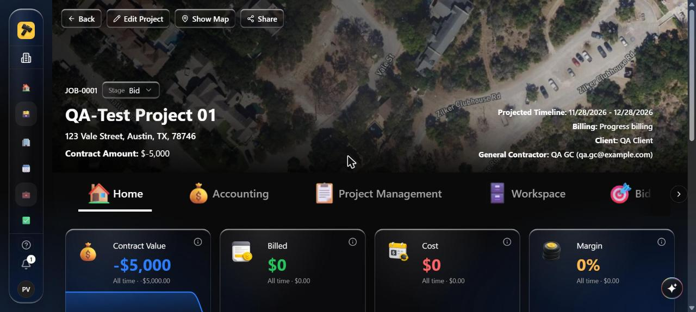
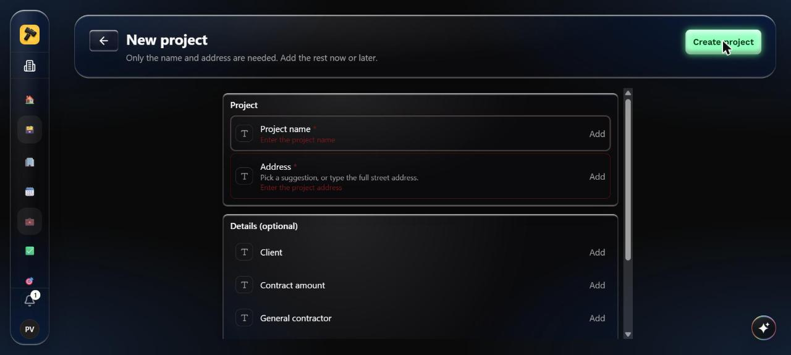
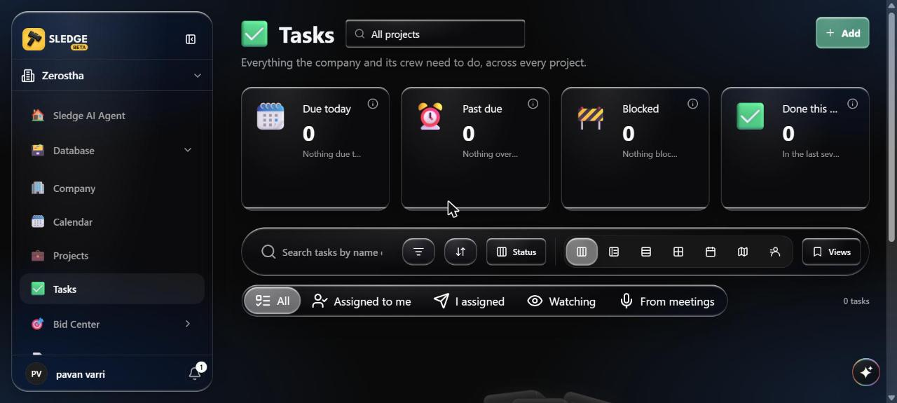

# Sledge: New Project flow, bug report

Tested on https://www.getsledge.com (production), workspace "Zerostha", 18 Nov 2026.
Chrome 157 on Windows, 1280x631 viewport.
Test record: **QA-Test Project 01** (`/projects/451`, JOB-0001).

**Flow under test:** Projects > Add > Create Manually. It feeds bills, lien waivers and contracts, so bad data here spreads everywhere downstream.

## How I tested

1. Explored each module read-only, with console and network open.
2. Tried the form field by field: empty, whitespace, invalid email, negative amount, end date before start date, typed address vs. autocomplete.
3. Created one project and compared what the UI showed with what `GET /api/v1/projects/:id` stored. That comparison exposed SLG-01 and SLG-02.
4. Measured instead of eyeballing: WCAG contrast from computed colours, truncation from `scrollWidth`, payload size, HTTP status codes.
5. Automated the flow and every bug as a regression test (`tests/`).

## Summary

| ID | Title | Priority |
| --- | --- | --- |
| [SLG-01](#slg-01) | Typed street address is silently replaced by an autocomplete suggestion (different street and ZIP) | P1 High |
| [SLG-02](#slg-02) | End date before start date is accepted, and the project page shows an end date that was never entered | P1 High |
| [SLG-03](#slg-03) | Negative contract amount accepted and shown in three different formats | P2 Medium |
| [SLG-04](#slg-04) | Read-aloud fails silently: `POST /api/v1/speech/say` returns 429 on every New Project load | P2 Medium |
| [SLG-05](#slg-05) | Form validation errors have 1.97:1 contrast (WCAG AA needs 4.5:1) | P2 Medium |
| [SLG-06](#slg-06) | KPI card labels and subtitles truncated at 1280px | P3 Low |
| [SLG-07](#slg-07) | Project API returns a 1,536-number address embedding (87% of the payload) | P3 Low |
| [SLG-08](#slg-08) | Analytics proxy `/ph/*` returns 400 on every page | P3 Low |

Each bug has a matching test in `tests/known-bugs.spec.ts`.

---

## SLG-01

**Typed street address is silently replaced by an autocomplete suggestion** · P1 High

**What the user does:** On Create Manually, types the full job-site address. The field hint says "Pick a suggestion, or type the full street address." They click **Next** without choosing a suggestion and expect their address to be saved.

**Actual:** Typed `123 QA Test Street, Austin, TX 78701`. After **Next** the field shows `123 Vale Street, Austin, TX 78746`, the first suggestion, with a different street and ZIP. It is saved that way (`address: "123 Vale Street"`, `postalCode: "78746"`) and the project page shows a satellite map of the wrong place. Nothing tells the user their input changed.

Reproduced 2/2. It happens when the top suggestion starts with the same house number. With `999 Nonexistent Builder Lane, Denver, CO 80202` the typed value was kept, so the behaviour is also inconsistent.

**Expected:** If no suggestion is picked, the typed address is kept, as the hint says. Any auto-selection needs an explicit confirmation.

**Steps**
1. Projects > **Add** > **Create Manually**
2. Click **Address**, type `123 QA Test Street, Austin, TX 78701`, wait for suggestions
3. Don't click a suggestion. Click **Next**
4. The Address row now reads `123 Vale Street, Austin, TX 78746`

**Impact:** The address drives lien waivers, notices, permits and the map. A wrong address saved without warning can invalidate legal documents or send a crew to the wrong site.

**Evidence:** 

---

## SLG-02

**End date before start date is accepted; the project page shows an end date that was never entered** · P1 High

**Actual**
- Start **11/28/2026**, end **11/02/2026**. No warning in the wizard or on Create, and `POST /api/v1/projects` returns **201**.
- The API stores `projectStartDate: 2026-11-28` and `projectEndDate: 2026-11-02`, so the server does not validate it either.
- The header shows **"Projected Timeline: 11/28/2026 - 12/28/2026"**. 12/28 was never entered and does not match the stored value.
- The date picker does not disable days before the chosen start date.

**Expected:** An end date earlier than the start date is rejected with a clear message, in the UI and by the API (400). The project page shows the stored dates.

**Steps**
1. Create Manually, fill Project name and Address
2. Start date: 28 Nov 2026, Apply. End date: 2 Nov 2026, Apply
3. Click **Create project**. It succeeds
4. Read "Projected Timeline" in the project header
5. `GET /api/v1/projects/451` returns `projectEndDate: "2026-11-02T00:00:00.000Z"`

**Impact:** Invalid data is stored, and the UI shows a different date from the stored one. Calendar, overdue flags, "behind schedule" answers and billing cycles can all disagree with what the user sees.

**Evidence:** same screenshot as SLG-01, "Projected Timeline: 11/28/2026 - 12/28/2026" top right.

---

## SLG-03

**Negative contract amount accepted and shown in three formats** · P2 Medium

**Actual:** `-5000` is accepted (`<input type="number">` has no `min`; the API stores `contractAmount: "-5000.00"`). The wizard shows `-5000`, the header shows **`$-5,000`**, and the Contract Value card shows **`-$5,000`**.

**Expected:** Amount must be 0 or more, checked in the UI and the API. One currency format everywhere.

**Steps:** Create Manually > Contract amount `-5000` > Next > fill name and address > Create > look at the header and the Contract Value card.

**Impact:** Contract value feeds margin, billing and dashboard totals. Negative values distort every total they are part of.

**Evidence:** same screenshot as SLG-01, header "Contract Amount: $-5,000" and card "-$5,000".

---

## SLG-04

**Read-aloud fails silently (429 on `/api/v1/speech/say`)** · P2 Medium

**Actual:** Read-aloud is on by default ("Turn read aloud off"). `POST https://api.getsledge.com/api/v1/speech/say` returns **429** on every load of `/projects/new` (3/3 loads), including the first of the session. Console: `AxiosError: Request failed with status code 429`. Nothing plays and the UI says nothing.

**Expected:** Read-aloud works on first use. If it is rate limited or unavailable, the UI says voice is unavailable and stops calling the endpoint.

**Context:** account `subscription/status` = `incomplete`, `agent/usage.aiEnabled = true`.

**Impact:** A headline voice feature looks broken with no explanation, and every page load spends a call that fails.

**Evidence:** network log only (DevTools > Network, filter `speech`). Asserted by the SLG-04 test.

---

## SLG-05

**Validation errors are nearly invisible (1.97:1 contrast)** · P2 Medium

**Actual:** After **Create project** with the required fields empty, "Enter the project name" and "Enter the project address" render at 12px in `oklch(0.396 0.141 25.7)`, about rgb(130,24,26), on a near-black background: **1.97:1**. It is lower on the selected (blue) row.

**Expected:** Error text meets WCAG 2.1 AA (4.5:1 for small text), for example `#f87171` on dark backgrounds.

**Impact:** Users with low vision, or in sunlight on a job site, cannot see why Create did nothing. It is also an accessibility compliance issue.

**Evidence:** 

---

## SLG-06

**KPI card labels truncated at 1280px** · P3 Low

**Actual:** At 1280px, labels and subtitles get ellipses inside 84px of a ~220px card: "Done this ..." (needs 101px), "In the last sev...", "Nothing due t...", "Total Proje...", "Active Proj...", "Needs atte...". Seen on Tasks, Company and Projects.

**Expected:** Labels fit or wrap at common widths (1280px and up), and the text column uses the card's full width.

**Related copy issue:** "Done this week" has the subtitle "In the last seven days". A calendar week and a rolling 7 days are different things.

**Impact:** Key metrics are unreadable without hovering.

**Evidence:** 

---

## SLG-07

**Project API sends a 1,536-dimension address embedding to the browser** · P3 Low

**Actual:** `GET /api/v1/projects/451` returns 22,063 bytes. **19,244 bytes (87%)** are `addressEmbedding` (1,536 floats). The UI never uses it.

**Expected:** Server-side vectors are left out of client responses.

**Impact:** Each project response is about 8x larger than needed, which gets worse on list endpoints and mobile networks, and it exposes internal ML data.

**Evidence:** response body of the request above (DevTools > Network). Asserted by the SLG-07 test.

---

## SLG-08

**Analytics proxy returns 400 on every page** · P3 Low

**Actual:** `POST /ph/e/` and `/ph/i/v0/e/` (PostHog proxy) return **400** on every page load. `...lambda-url.us-east-1.on.aws/scripts` also returns 400.

**Expected:** 2xx, events recorded.

**Impact:** Product analytics and funnels silently lose data.

**Evidence:** network log only (DevTools > Network, filter `ph`). Asserted by the SLG-08 test.

---

## What worked

- Create with name and address empty is blocked. Both fields show errors and the wizard opens on the first one.
- A whitespace-only project name is treated as empty.
- An invalid GC email is flagged ("Enter a valid email address") and blocks Create.
- A valid project is created (201) and opens on its detail page with a "Project created" toast.
